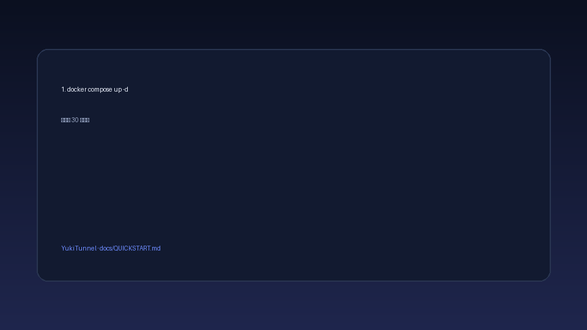
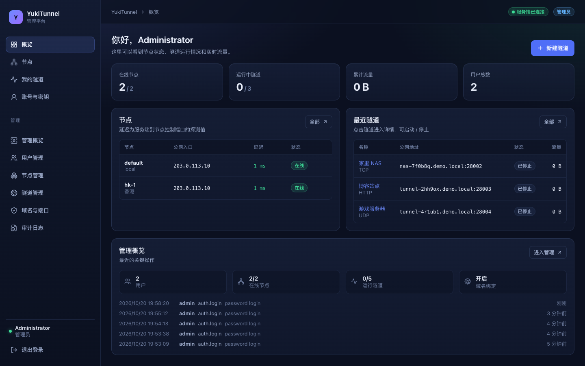
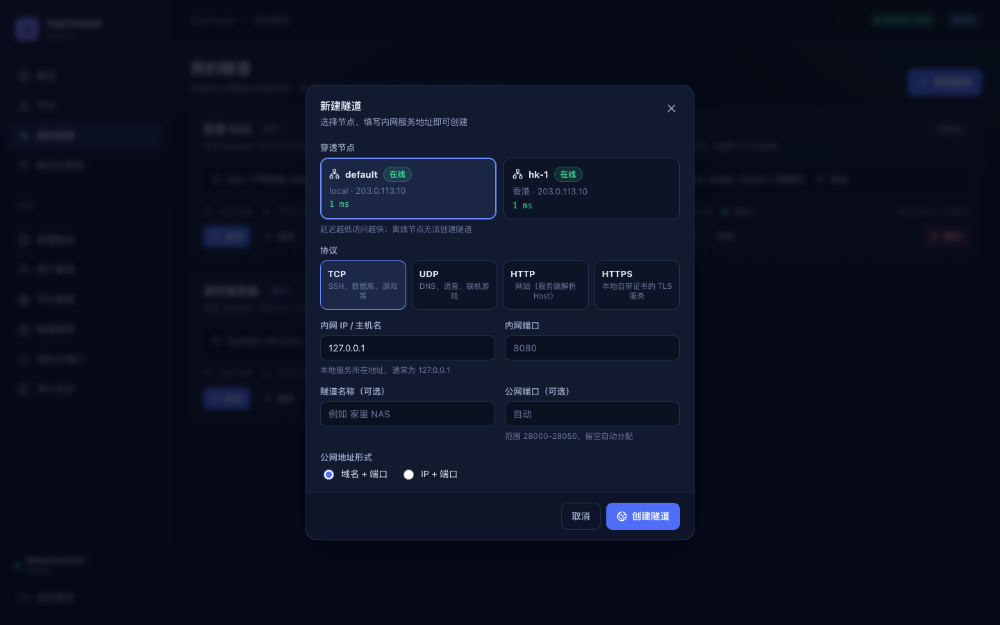
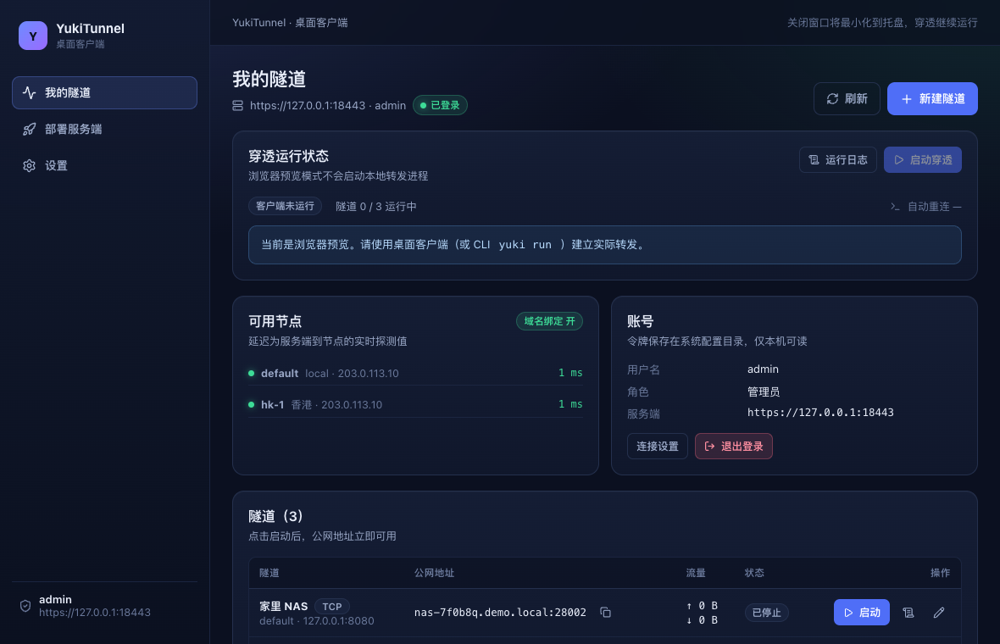
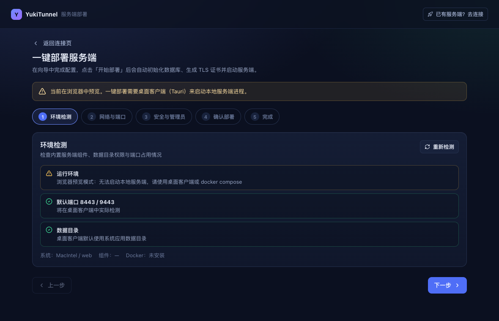

<div align="center">

# YukiTunnel

**开源自托管内网穿透平台 · 服务端一键部署 · 客户端全图形化 · 云安全组自动放行**

[](https://github.com/yuuuuukiu/yukitunnel/actions/workflows/ci.yml)
[](https://github.com/yuuuuukiu/yukitunnel/releases)
[](https://go.dev)
[](https://react.dev)
[](https://tauri.app)
[](LICENSE)
[](docs/RELEASE-NOTES-v0.1.0.md)

把家里的 NAS、开发服务器、数据库安全地暴露到公网 —— 不需要写任何配置文件。

</div>

---

## 30 秒快速开始

```bash
# 1. 服务端（一台有公网 IP 的机器）
git clone https://github.com/yuuuuukiu/yukitunnel.git && cd yukitunnel
cp .env.example .env      # 改 YUKI_PUBLIC_HOST 和 YUKI_ADMIN_PASSWORD
docker compose up -d --build

# 2. 客户端
yuki login --server https://<你的IP>:8443 --username admin --insecure
yuki tunnel create --proto tcp --local-ip 127.0.0.1 --local-port 8080
yuki run
```

返回的公网地址形如 `203.0.113.10:20001`，从任何地方访问即可。

> 完整步骤（含桌面端、TLS、域名、排错）：[docs/QUICKSTART.md](docs/QUICKSTART.md)

---

## 演示



> GIF 路径：`docs/screenshots/quickstart.gif`（30 秒录屏：部署 → 登录 → 建隧道 → 访问）

| WebUI 概览 | 创建隧道 |
| --- | --- |
|  |  |

| 桌面客户端 | 一键部署向导 |
| --- | --- |
|  |  |

更多截图见 [docs/SCREENSHOTS.md](docs/SCREENSHOTS.md)。

---

## 为什么是 YukiTunnel

| | 传统 frp | YukiTunnel |
| --- | --- | --- |
| 客户端配置 | 手写 TOML/INI | 图形向导：填地址 → 登录 → 点「+」 |
| 服务端部署 | 手动配置 systemd | `docker compose up -d --build` 或桌面端一键部署 |
| 用户管理 | 无 | WebUI / 桌面端 / CLI 三端一致 |
| 认证 | token | 密码（Argon2id）+ RSA/SSH Key 挑战签名 |
| 公网地址 | 自己拼 | 自动返回「域名+端口」或「IP+端口」 |
| 云安全组 | 手工点控制台 | 声明式 Profile 自动放行，ed25519 验签 |
| 主机防火墙 | 手工 ufw/firewall-cmd | 自动检测并放行，停止时回收 |

---

## 架构

```
┌──────────────┐   HTTPS :8443    ┌─────────────────────────────────────┐
│   浏览器      │─────────────────▶│                                     │
│  (WebUI)     │                  │        yuki-server（单二进制）        │
└──────────────┘                  │                                     │
                                  │  ┌───────────┐  ┌────────────────┐  │
┌──────────────┐   WSS :9443      │  │ REST API  │  │  tunnel.Hub    │  │
│ 客户端 GUI   │─────────────────▶│  │ /api/v1   │  │  会话 / 监听器  │  │
│ / CLI        │   yamux 多路复用  │  └───────────┘  └───────┬────────┘  │
└──────┬───────┘                  │  ┌───────────┐          │           │
       │                          │  │  SQLite   │   ┌──────▼───────┐   │
       │ 每条隧道一个 stream        │  │ users     │   │ 公网端口      │   │
       ▼                          │  │ tunnels   │   │ 20000-20100  │   │
┌──────────────┐                  │  │ profiles  │   └──────▲───────┘   │
│ 内网服务      │◀─────────────────│  └───────────┘          │           │
│ 127.0.0.1:8080│   agent 本地转发  │  ┌───────────┐  ┌──────┴───────┐   │
└──────────────┘                  │  │ firewall  │  │ 公网访问者    │   │
                                  │  │ ufw/nft   │  └──────────────┘   │
                                  │  └───────────┘                      │
                                  └─────────────────────────────────────┘
                                                │
                                   ┌────────────▼────────────┐
                                   │  Profile Registry        │
                                   │  GitHub + ed25519 签名   │
                                   │  R2 / jsDelivr / raw     │
                                   └────────────┬────────────┘
                                                │ 放行云安全组端口
                                   ┌────────────▼────────────┐
                                   │ 阿里云 / 腾讯云 / AWS    │
                                   │ 华为云 / Azure / GCP     │
                                   └─────────────────────────┘
```

**数据面**：客户端 WSS 连接 → yamux → 首条流为控制流 → 每条公网连接一个流。
**关键设计**：公网监听器在服务端，客户端只转发，因此启停由 API 直接生效，
客户端离线时隧道标记待恢复，重连自动拉起。

---

## 功能

### 服务端

- 单二进制（内嵌 WebUI）、SQLite、强制 TLS
- 多节点、实时延迟、域名绑定开关、端口范围配置
- 审计日志、登录防爆破、令牌管理
- 系统防火墙自动放行（ufw / firewalld / nftables）

### 三端对等管理

WebUI、桌面管理端、`yuki-server` CLI 覆盖同一组能力：
用户 / 节点 / 隧道 / 域名开关 / 端口范围 / 审计 / 云 Profile。

### 客户端

- 全图形化：首次向导、节点延迟、一键创建与启动、托盘常驻、自动重连
- CLI 功能对等，全部命令支持 `--json`

### 云 Profile 生态

声明式 YAML 描述「如何在云平台放行端口」，新增厂商无需改代码。

```
GitHub: yuuuuukiu/yukitunnel-profiles
  ├── profiles/*.yaml          6 个官方 profile
  ├── index.json               CI 自动生成
  └── index.json.sig           ed25519 签名
        │
        ▼  多源回退：官方镜像 → jsDelivr → GitHub raw → 自定义 → 缓存
客户端：内置公钥验签 → 校验 sha256 → 校验结构 → 执行
```

| 厂商 | 端口写法 | 协议大小写 | 签名 | 状态 |
| --- | --- | --- | --- | --- |
| 阿里云 | `8000/8010` | `tcp` | HMAC-SHA1 | ⚠️ mock |
| 腾讯云 | `8000-8010` | `TCP` | TC3-HMAC-SHA256 | ⚠️ mock |
| AWS | `FromPort`/`ToPort` | `tcp` | SigV4 | ⚠️ mock |
| 华为云 | `port_range_min/max` | `tcp` | IAM Token | ⚠️ mock |
| Azure | `"8000-8010"` | `Tcp` | OAuth2 | ⚠️ mock |
| GCP | `["8000-8010"]` | `tcp` | OAuth2 | ⚠️ mock |

> ⚠️ mock = 只用本地 HTTPS 端点验证了请求结构、签名与端口方言，**尚未用真实账号联调**。
> 上线前请按 [docs/CLOUD-LIVE-TEST.md](docs/CLOUD-LIVE-TEST.md) 自测。

- 签名校验**无法关闭**，缓存也验签
- `allowed_hosts` 白名单阻止凭证外发
- dry-run、幂等探测、权限确认
- 支持 HTTP / SOCKS5 代理

详见 [docs/CLOUD-PROFILES.md](docs/CLOUD-PROFILES.md) 与 [docs/PROFILE-GUIDE.md](docs/PROFILE-GUIDE.md)。

---

## 安装

### 服务端

```bash
# Docker
cp .env.example .env && docker compose up -d --build

# 二进制
sudo ./yuki-server init --data-dir /var/lib/yukitunnel \
  --public-host 203.0.113.10 --admin-password 'ChangeMe-Str0ng!' \
  --port-min 20000 --port-max 20100
sudo ./yuki-server start --data-dir /var/lib/yukitunnel
```

### 客户端

| 平台 | 文件 |
| --- | --- |
| Windows x64 / x86 | `yuki-windows-amd64.exe` / `yuki-windows-386.exe` |
| macOS Intel / ARM | `yuki-darwin-amd64` / `yuki-darwin-arm64` |
| Linux x64 / ARM | `yuki-linux-amd64` / `yuki-linux-arm64` |
| Linux 桌面 | `YukiTunnel-x86_64.AppImage` |

---

## 从源码构建

```bash
# 依赖：Go 1.24+、Node 20+ / pnpm、Rust 1.77+（桌面端）
make build          # WebUI + yuki + yuki-server -> bin/
make sidecars       # 桌面端 sidecar
cd desktop && pnpm install && pnpm tauri:build

# 其他平台
bash scripts/build-windows.ps1 -Arch all      # Windows（在 Windows 上执行）
bash scripts/build-appimage.sh                # Linux AppImage
```

常用命令：

```bash
make test           # 单元 + 集成测试
make test-smoke     # 端到端冒烟
bash scripts/e2e-local.sh          # 全链路（Docker）
bash scripts/e2e-local.sh --no-docker
bash scripts/live-test-aliyun.sh   # 真实云联调（需凭证）
make help           # 全部命令
```

---

## 文档

| 文档 | 内容 |
| --- | --- |
| [STATUS.md](STATUS.md) | **当前状态：已完成什么、还差什么** |
| [docs/QUICKSTART.md](docs/QUICKSTART.md) | 5 分钟跑通 + 常见错误排查 |
| [docs/DEPLOYMENT.md](docs/DEPLOYMENT.md) | Compose 参数、R2 secrets、镜像与代理 |
| [docs/PROFILE-GUIDE.md](docs/PROFILE-GUIDE.md) | Profile YAML 格式、签名、PR 流程 |
| [docs/CLOUD-PROFILES.md](docs/CLOUD-PROFILES.md) | 六厂商参数对照与引擎设计 |
| [docs/CLOUD-LIVE-TEST.md](docs/CLOUD-LIVE-TEST.md) | 最小权限子账号与联调步骤 |
| [docs/FIREWALL.md](docs/FIREWALL.md) | 系统防火墙适配 |
| [docs/CLI.md](docs/CLI.md) | `yuki` 与 `yuki-server` 命令参考 |
| [docs/API.md](docs/API.md) | REST API 与错误码 |
| [docs/ARCHITECTURE.md](docs/ARCHITECTURE.md) | 架构、数据库、数据面协议 |
| [docs/DESIGN.md](docs/DESIGN.md) | 完整设计方案 |
| [docs/ACCEPTANCE-PROFILES.md](docs/ACCEPTANCE-PROFILES.md) | 测试覆盖与联调记录 |
| [docs/RELEASE-CHECKLIST.md](docs/RELEASE-CHECKLIST.md) | 发布检查清单 |
| [docs/RELEASE-NOTES-v0.1.0.md](docs/RELEASE-NOTES-v0.1.0.md) | v0.1.0 发布说明 |
| [SECURITY.md](SECURITY.md) | 威胁模型与漏洞报告 |
| [docs/SETUP-SECRETS.md](docs/SETUP-SECRETS.md) | **Secrets 在哪里填、填什么**（照着做） |
| [docs/SECRETS.md](docs/SECRETS.md) | 密钥与凭证管理（GitHub Secrets 安全模型） |

---

## 安全

- 全链路 TLS，密码 Argon2id，令牌只存 SHA-256
- RSA/SSH Key 挑战签名，私钥永不离开客户端
- 云凭证 AES-256-GCM 静态加密，API 返回 `****`
- Profile 签名强制校验，`allowed_hosts` 防外发
- 关键操作全部审计

细节与报告流程：[SECURITY.md](SECURITY.md)

---

## 状态

**v0.1.0 beta**。阿里云与腾讯云已完成真实账号联调；AWS / 华为云 / Azure / GCP
目前为 mock 验证。详见 [发布说明](docs/RELEASE-NOTES-v0.1.0.md)。

---

## 贡献

欢迎 Issue 与 PR。开始之前请读 [CONTRIBUTING.md](CONTRIBUTING.md)（含环境搭建、提交前自检、几处容易踩的坑）与[行为准则](CODE_OF_CONDUCT.md)。

- 新增云厂商 → [Profile 请求模板](.github/ISSUE_TEMPLATE/profile-request.md)
- 报告 Bug → [Bug 模板](.github/ISSUE_TEMPLATE/bug-report.md)（请附 `yuki-server doctor` 输出）
- 安全漏洞 → [SECURITY.md](SECURITY.md)（不要公开）

开发前阅读 [docs/DEVELOPMENT.md](docs/DEVELOPMENT.md)，提交前确保
`make test`、`bash scripts/e2e-local.sh --no-docker`、`pnpm build`、`cargo check` 均通过。

---

## License

MIT
