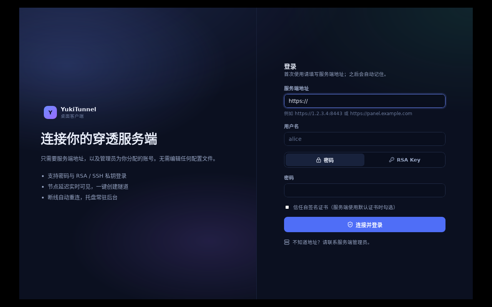

# Linux 构建与 AppImage

## 产物

| 文件 | 说明 |
| --- | --- |
| `dist/YukiTunnel-x86_64.AppImage` | 桌面客户端 + 内置 `yuki` / `yuki-server`，58.4 MB |

校验和：`8e275df52231a48f1b5f76046aa598b6310cb72391be201d7a596f9c8c8610d4`

结构（type-2 AppImage）：

```
0        ELF runtime (x86-64, 193728 bytes, e_ident[8..10] = "AI\x02")
193728   SquashFS 1.4 (zstd, 128K block, 26 inodes)
```

AppDir 内容：

```
AppRun                                  # 入口，注入 bundled 二进制到 PATH
yukitunnel.desktop / .DirIcon / yukitunnel.png
usr/bin/yukitunnel-desktop              # Tauri 主程序（前端已内嵌）
usr/lib/yukitunnel/yuki-server          # 服务端（内嵌 WebUI）
usr/lib/yukitunnel/yuki                 # 客户端 CLI
usr/lib/libwebkit2gtk-4.1.so.0 …        # GTK/WebKit 依赖
```

## 使用

```bash
chmod +x YukiTunnel-x86_64.AppImage
./YukiTunnel-x86_64.AppImage              # 启动图形客户端

# 从 AppImage 里直接调用 CLI（无需安装）
./YukiTunnel-x86_64.AppImage --appimage-extract
./squashfs-root/usr/lib/yukitunnel/yuki-server version

# 或把内置二进制暴露到 PATH
export PATH="$PWD/squashfs-root/usr/lib/yukitunnel:$PATH"
yuki login --server https://panel.example.com:8443 --username alice
```

首次运行需要 `libfuse2`（Ubuntu 24.04+ / Debian 13+ 上是 `libfuse2t64`）；没有 FUSE 时用 `--appimage-extract` 解包后直接运行 `AppRun`。

## 构建

```bash
# 在 Debian/Ubuntu/Kali 容器或主机上（需要 Rust stable、Go 1.24+、pnpm）
bash scripts/build-appimage.sh
```

依赖：

```bash
apt-get install -y build-essential pkg-config libssl-dev \
  libwebkit2gtk-4.1-dev libgtk-3-dev libayatana-appindicator3-dev librsvg2-dev \
  patchelf mksquashfs curl
```

脚本流程：构建 WebUI → 构建 `yuki-server` / `yuki`（linux/amd64）→ `cargo build --release --features custom-protocol` → 组装 AppDir → `mksquashfs` → 拼接 runtime → 解包自检。

### 两个必须注意的点

1. **`--features custom-protocol` 不能省。**
   Tauri 2 用这个 feature 区分 dev 与生产：缺失时二进制会去连 `http://localhost:1420`（devUrl），AppImage 启动后只有一句
   `Could not connect to localhost: Connection refused`。`tauri build` 会自动加，裸 `cargo build --release` 不会。

2. **不要依赖 `appimagetool` 在模拟环境里跑。**
   它本身是一个 AppImage，runtime 的 `e_ident[8..10]` 写着 `AI\x02`（AppImage 专有 ABI 标记），
   QEMU user-mode 会直接拒绝执行（`Exec format error`）。脚本改为「下载 runtime + 手工拼接 squashfs」，
   产出的就是标准 type-2 AppImage，且可在任意架构的构建机上完成。

## 本次验证记录（Kali Rolling 2026.3 容器，x86-64 模拟）

```text
$ scripts/build-appimage.sh
==> Building Go binaries (linux/amd64)   yuki-server 0.1.0-linux / yuki 0.1.0-linux
==> Compiling Tauri binary               28 MB ELF x86-64
==> Packing squashfs                     1547 files
==> Assembling type-2 AppImage           58.4 MB

# 结构校验
squashfs offset : 193728  (= runtime ELF end)
squashfs magic  : 0x73717368  ver 1.4  block 131072  inodes 26
ELF machine     : 0x3e (x86-64)
e_ident[8..10]  : b'AI\x02'

# 载荷执行（解包后）
$ yuki-server version   → yuki-server 0.1.0-linux
$ yuki --version        → yuki version 0.1.0-linux

# 端到端（用 AppImage 内的二进制）
$ yuki-server init --api-addr 127.0.0.1:18443 --control-addr 127.0.0.1:19443 \
    --admin-password admin12345 --port-min 28000 --port-max 28010
$ yuki-server serve &
$ curl -sk https://127.0.0.1:18443/api/v1/health   → {"status":"ok","version":"0.1.0-linux"}
$ yuki login --server https://127.0.0.1:18443 --username alice --password alice12345 --insecure
  ✓ 登录成功
$ yuki tunnel create --proto tcp --local-port 18080 --no-domain   → 127.0.0.1:28000
$ yuki run &
$ yuki tunnel start tun_…        → ✓
$ curl http://127.0.0.1:28000/   → 200（内网服务内容）
$ yuki tunnel stop tun_…         → ✓
$ curl http://127.0.0.1:28000/   → 000（连接被拒绝）
$ yuki tunnel delete tun_… -y    → ✓

# GUI 启动（Xvfb :99，1280x800）
$ ./usr/bin/yukitunnel-desktop &
  RUNNING；窗口渲染出「连接你的穿透服务端」登录页（截图见下）
```



## 已知限制

- 本次在 x86-64 模拟环境（QEMU user-mode）中构建，因此无法直接执行 AppImage runtime 本体来验证挂载；
  已通过「解包 + 逐字节校验 squashfs 偏移/魔数」与「载荷二进制实跑」两条路径验证。
  在有原生 x86-64 Linux 的机器上 `./YukiTunnel-x86_64.AppImage` 可直接运行。
- 只产出 x86-64；arm64 AppImage 需在 arm64 Linux 上以 `ARCH=aarch64` 运行同一脚本（runtime 需换 `runtime-aarch64`）。
- AppImage 未做 GPG 签名与 zsync 增量更新。
